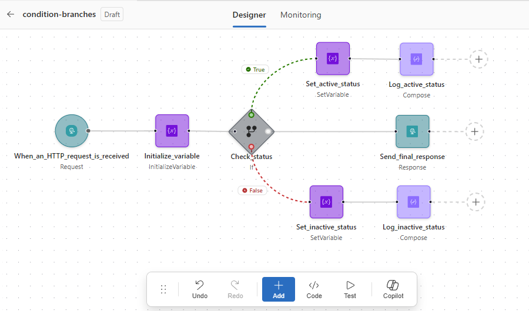

## Overview

In Azure Logic Apps Automation, the *designer* provides a visual drag-and-drop canvas where developers can shape workflows. Every workflow component, such as the trigger, each action, agent, and MCP server, has a parameters pane for inputs and settings, code view, and outputs view so you can easily move between the visual representation and the underlying JSON.

## What you can build on the designer

The following table describes only some of the components that you can use on the designer to build your workflow:

| Component | Description |
|---|---|
| Trigger | Starts the workflow from an HTTP call, a schedule recurrence, a queue message, an event, or another workflow. |
| Action | Run one or more steps that perform tasks on other services, systems, apps, and data, execute inline JavaScript, or call other workflows. |
| Control flow | Structure your workflow with `if-else`, `switch`, `for-each`, `do-until`, and parallel branch constructs. |
| Nested logic | Group actions into scopes. Nest control flow constructs as deeply as you need. |
| Variables and expressions | Capture intermediate values and reference them by using expressions. |

## Conditional branches

The designer visually renders control flow constructs. The following example shows a condition with true and false branches:

## View and edit component information

To view a component's parameters, code, or other information, on the designer, select that component.

The following synthetic example shows an action's parameters with fictional values:

## View and edit underlying JSON

To view the entire workflow's underlying JSON alongside the designer, on the bottom toolbar, select **Code**. Changes that you make in one view instantly appear in the other.

The following synthetic example illustrates the code view; it isn't a validated workflow definition:

## Save and run workflows

Before testing or publishing a workflow, confirm the expected behavior with your administrator and review actions that can affect connected systems. For UI steps, see [Test for missing setup details](/getting-started/quickstart/#5-test-for-missing-setup-details).

## Related content

- [AI assistant](/features/ai-assistant/)
- [Connectors](/features/connectors/)
- [Report a bug](/support/report-a-bug/)
