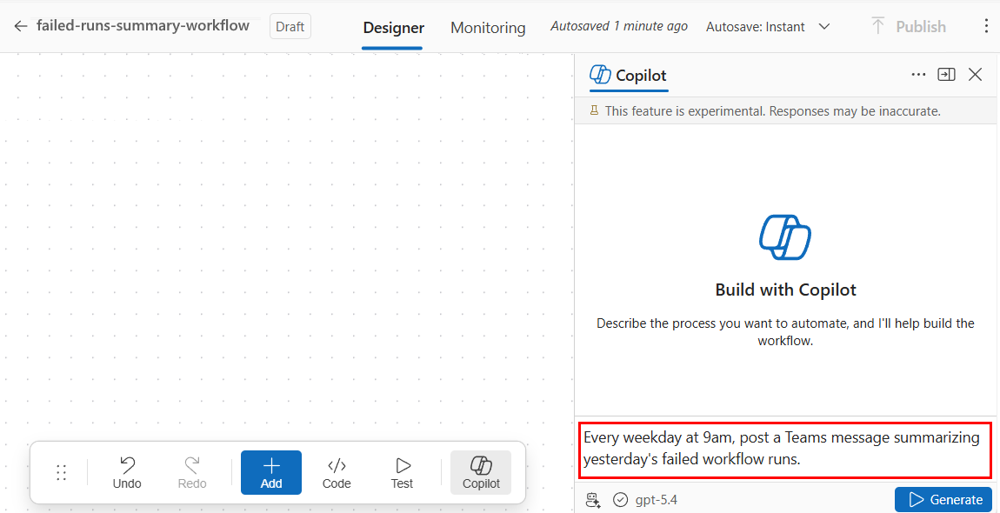
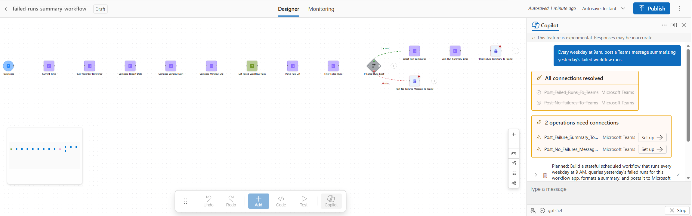
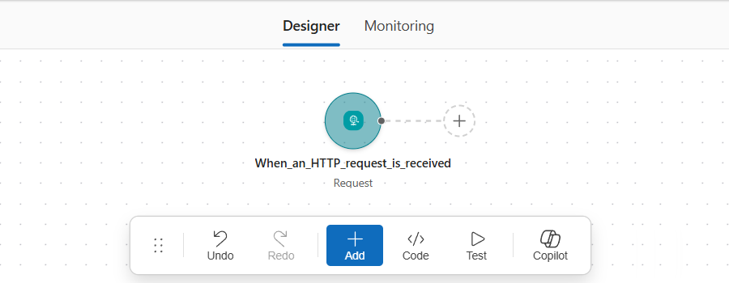
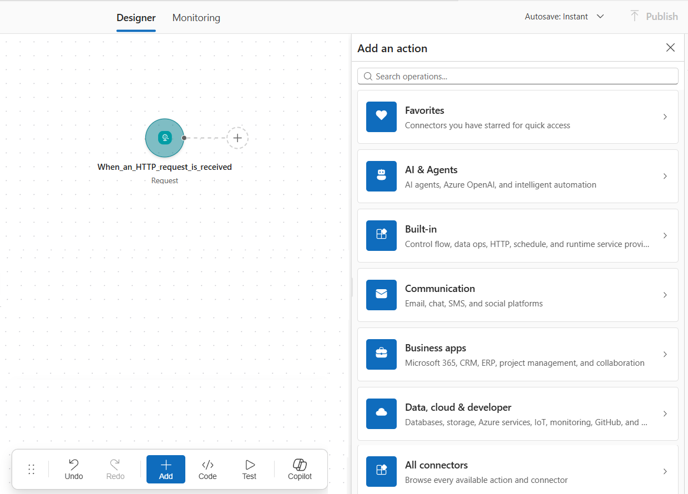
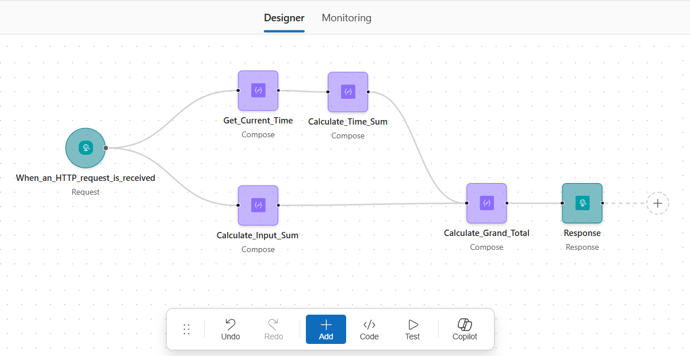
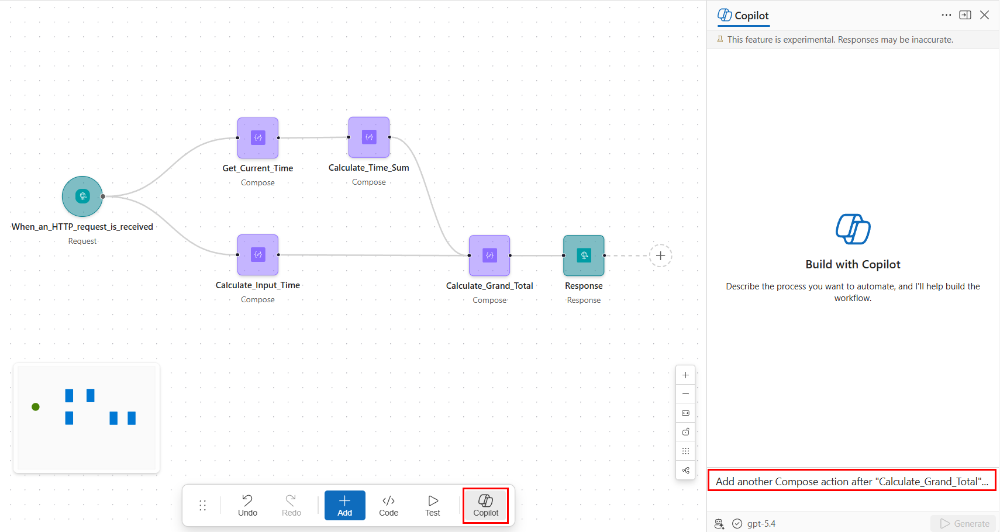
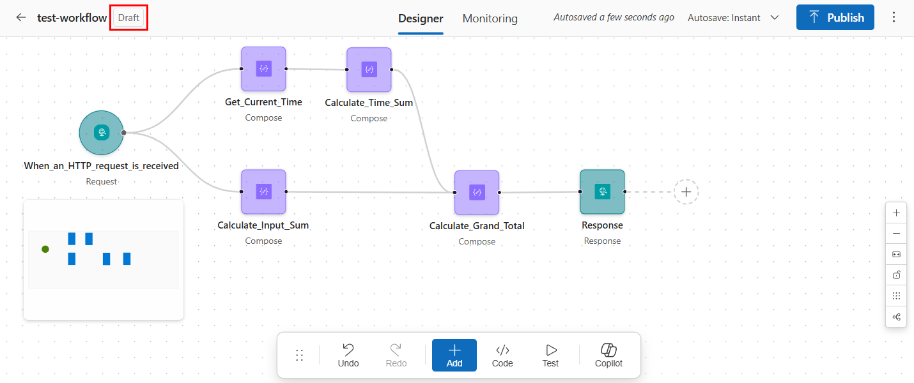
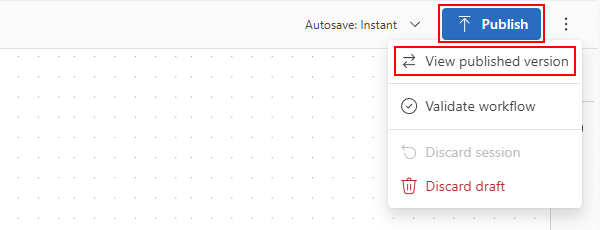

## Overview

In this quickstart, open an environment, create or select an app, build a workflow, and review its run history. An [app](/features/projects-and-applications/#apps) groups related workflows, connections, and settings. A [workflow](/features/workflows/) starts with a trigger and performs the actions you configure.

Choose a trigger and actions for the task you want to automate. Configure their required inputs and connections before testing.

This general guide doesn't yet include a complete tested example with input and expected output.

Screenshots labeled synthetic show fictional, independent examples, not a single workflow or actual runs.

## How to

Review the requirements, then [open an environment](#1-open-your-environment), [create or select an app](#2-create-an-app), and [build a workflow](#3-create-your-workflow). The later sections cover testing, publishing, and monitoring.

## Requirements

- A Microsoft work or school account in the same Microsoft Entra tenant as the environment that you want to use.

  Your account must exist in the same tenant so an environment administrator can add you to the environment. You don't need an Azure subscription to create apps and workflows in an automation environment.

- Access to the [Azure Logic Apps Automation portal](https://auto.azure.com).

- Access to an environment and an app where you can build workflows. Confirm the required assignments with your environment or app administrator before you start.

  If you don't have environment access, contact your environment administrator so they can validate and assign the required permissions.

## 1. Open your environment

1. Sign in to the [Azure Logic Apps Automation portal](https://auto.azure.com).

   The portal opens and shows every environment where you currently have access. If you don't see the expected environments, contact your environment administrator to validate your assignments.

1. On the **Environments** tab, select your environment.

   The portal opens the environment and shows the **Apps** page.

1. If the environment is empty, go to the next section to create an app. 

   Otherwise, select the app where you want to create your workflow, and skip to [Create your workflow](#3-create-your-workflow).

## 2. Create an app

If your environment doesn't include an app to store and organize workflows, follow these steps to create an app:

1. In the environment, on the **Apps** page, select **Create app**.

1. In the **Create application** box, for **Application name**, enter a name for your app, and select **Create**.

   The following synthetic example uses a fictional app name:

   

   The portal might take a couple minutes to create your app.

1. To check that the app is ready for you to open and continue, review the **Status** column.

1. After app creation completes, select your app.

   The portal opens the app and shows the **Workflows** list.

1. If others need to create workflows in your app, [add them as app members](#add-app-members).

## 3. Create your workflow

1. In your app, on the **Workflows** page, select **Create workflow**.

1. In the **Create workflow** box, enter the name, and select **Create**.

   The following synthetic example uses a fictional workflow name:

   

1. After the portal opens the designer, choose an option to start creating your workflow.

   | Option | Path |
   |---------|------|
   | **AI assistant** | Generate your workflow on the designer, based on your description about what the workflow does.   For more information, see [Generate workflow with assistant](#3a-generate-a-workflow-with-the-assistant). |
   | **Designer** | Add the trigger and each action from the connectors library. |

## 3a. Generate a workflow with the assistant

1. On the bottom toolbar, select **Copilot**.

1. In the chat box, enter your workflow description. Select **Generate**.

   The following example shows the AI assistant and a workflow description:

   

   The following example shows the assistant-generated workflow:

   

   :::important
   Generated workflows still need setup. The AI assistant generates the workflow scaffolding, such as the trigger, actions, branches, and so on. But the assistant doesn't know your credentials or environment-specific values. Before you run your first workflow, complete any required follow-up tasks.
   :::

1. Complete any remaining follow-up tasks that your workflow needs to run successfully, for example:

   - Add any required parameter values that the assistant left empty.
   
     1. Open the information box for the trigger and each action.

     1. Find the parameters marked with an asterisk or red outline.

   - Configure the connections for each connector trigger and action.
   
     - On your app sidebar, select **Connections**. Review each connection and complete the necessary setup.

     - In the designer, open the information box for the connector trigger and each action. Review the **Connection** tab and complete the necessary setup.

   - Resolve any prompts on the trigger or actions that show a label named **Finish configuring with Copilot**.

## 3b. Build a workflow with the designer

When you start with an empty designer, manually add the trigger and actions that provide your workflow's behavior.

### Add the trigger

Every workflow starts with a trigger, which identifies the event or condition that runs the workflow.

1. On the empty designer, select **Start from scratch** or **Add a trigger** to open the trigger picker.

   The following synthetic example shows the trigger picker:

   

1. Search or browse the triggers in the pane, and select the trigger you want.

   For example:

   | Trigger type | Trigger name | Description |
   |--------------|--------------|-------------|
   | **Request** | **When an HTTP request is received** | A webhook trigger that handles incoming requests sent from external callers. |
   | **Schedule** | **Recurrence** | A trigger that runs on a specified schedule. |

1. In the trigger information box, enter any required details, and then close the box.

   Your selected trigger appears on the designer, like the following example:
   
   

### Add an action

After the trigger, an action performs a specific task in the workflow.

1. On the designer, following the trigger, select the plus sign (+) to add an action.

1. When the **Add an action** pane opens, search or browse the actions. Select the action you want. 

   

1. In the action information box, enter any required details for the action to work, and then close the box.

   Your selected action appears on the designer.

   For actions that run in parallel, branches automatically appear on the designer. For example, the following workflow shows these branches and includes a final response back to the caller who sent the request:

   

### Other designer actions

On the designer, the bottom toolbar gives you the following controls, which are covered later in this guide:

| Action | Description |
|---|---|
| **Add** | Add an operation anywhere on the designer. |
| **Code** | View the raw underlying JSON alongside the designer. |
| **Test** | Open the workflow test controls. |
| **Copilot** | Open the AI assistant alongside the designer to iterate over your workflow. |

## 4. Edit your workflow with AI or in code

To continue editing your workflow, you have the following options:

- Keep using the designer.

- Describe your changes in natural language by opening the AI assistant.

- Directly edit the workflow's underlying JSON definition by switching to the code editor. Changes stay synchronized between the code editor and designer.

  The following example shows the AI assistant with instructions to edit a workflow:

  

  For an illustration of the code editor, see [View and edit underlying JSON](/features/visual-designer/#view-and-edit-underlying-json).

## 5. Test for missing setup details

Before using **Test**, review the workflow and its connections. A test can affect connected systems. For example, note the **Draft** label on the designer's title bar:

If **Test** isn't available, confirm how to test the workflow with your administrator before publishing or running it.

1. In the designer, on the bottom toolbar, select **Test** to open the **Test draft workflow** box.

1. In the **Trigger** box, confirm the selected trigger.

1. In the **Test data (JSON)** box, enter a sample JSON body that matches the inputs expected by your trigger and actions.

1. After you finish, select **Test Draft**.

   The **Monitoring** tab opens to show the running workflow. After the run completes, in a side window, the **Runs** tab shows the workflow's run history, including details such as status and duration.

## 6. Publish your workflow

Before selecting **Publish**, confirm its effect with your administrator and review the workflow and its connections. Workflow actions can affect connected systems.

1. On the **Designer** tab, in the upper right corner, select **Publish**.

1. To switch to the published workflow, next to **Publish**, from the vertical ellipses (**...**) menu, select **View published version**.

   

## 7. Run and monitor your workflow

Before running a workflow, confirm the version, inputs, and potential effects on connected systems. Then follow these steps:

1. Next to the **Designer** tab, select **Monitoring**.

1. Start a run by selecting **Run workflow** or **Run** from the **Runs** tab, based on which control appears in your portal view.

1. In the **Trigger** box, confirm the selected trigger.

1. In the **Test data (JSON)** box, enter the sample JSON body input that the trigger needs to run.

1. After you finish, select **Run**.

   The **Monitoring** tab opens to show the running workflow. After the workflow run completes, in a side window, the **Runs** tab shows the workflow's run history, including details such as status and duration.

## 8. Examine the run history

To explore the run history in more detail, follow these steps:

1. On the **Runs** tab, select the run you want.

   The following synthetic example shows fictional run statuses and timestamps:

   

1. On the canvas or in the execution log, select the trigger or an action to review the values on the pane with the **Output**, **Input**, and **Properties** tabs.

   If any actions failed, the same pane shows the error messages and stack trace so you can diagnose without changing context.

## 9. Iterate on your workflow

To edit your workflow, return to the **Designer** tab and select **Edit draft**. Or, send follow-up instructions to the assistant.

For example, you might ask the assistant to `add error handling to the HTTP action` or `use Slack to post alerts instead`.

Confirm save and publish behavior with your administrator before making release decisions.

## App ownership and privacy

Before relying on ownership or privacy assumptions, confirm the expected behavior and required access with your app or environment administrator.

For more information, see [Permissions](/features/permissions/).

## Add app members

To add team members to your app so they can build workflows, follow these steps:

For the distinction between environment and app access, see [Permissions](/features/permissions/).

1. In the [Azure Logic Apps Automation portal](https://auto.azure.com), on the **Environments** page, select the environment that contains your app.

1. On the **Apps** page, select the app. On the app sidebar, select **Settings**.

1. On the **Settings** page, select the **User permissions** tab, and complete the following steps:

   1. In the **Users** section, select **Add user**.

   1. On the **Add role assignment** pane, in the **Select user** box, browse for the person you want. Or, enter their email address.

      The **Select user** list shows only people in the same Microsoft Entra tenant as you.

   1. From the results, select the person you want.

1. After the **Role** section appears, select the role the person needs, based on the principle of least privilege, and then select **Add**.

   Confirm the role's capabilities with your administrator before assigning access.

## Next steps

- [Troubleshoot problems](/getting-started/troubleshoot/)
- [Designer](/features/visual-designer/)
- [AI assistant](/features/ai-assistant/)
- [Connectors](/features/connectors/)
- [Runs and monitoring](/features/runs-and-monitoring/)
- [Report a bug](/support/report-a-bug/)
