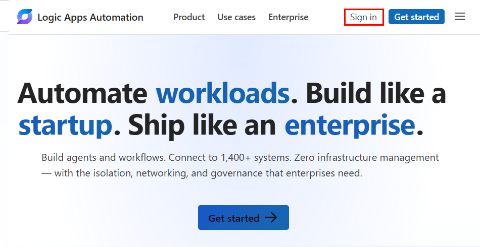

## Overview

When your team builds automation solutions, organize your apps, workflows, connections, and other items so that your team can find and manage them as it grows.

In Azure Logic Apps Automation, an *environment* is the top-level container for apps and related resources. As your first step, create an environment to store your apps and their contents. You can create an environment per team, business area, or scenario so teams can organize and manage automations in separate containers.

Azure Logic Apps Automation organizes your work at the following levels:

| Level | Contents |
|-------|----------|
| [*Environment*](/getting-started/introduction/#key-components-and-concepts) | The top-level parent container that stores *apps* and shared resources. |
| [*App*](/getting-started/introduction/#key-components-and-concepts) | Organizes workflows, connections, parameters, and app settings, and provides views of runs and analytics. |
| [*Workflow*](/getting-started/introduction/#key-components-and-concepts) | The automation workload itself, which includes the starting event ([*trigger*](/getting-started/introduction/#key-components-and-concepts)) and the steps ([*actions*](/getting-started/introduction/#key-components-and-concepts)) to run. |

This guide shows how to create an environment if you don't have one yet and add team members to your environment.

For more information, see:

- [What is Azure Logic Apps Automation](/getting-started/introduction/)
- [Key concepts and terminology](/getting-started/introduction/#key-components-and-concepts)

## How to

Review the requirements, then [create an environment](#create-your-environment) and [add members](#add-environment-members) if your team needs access.

## Requirements

- Confirm the account and subscription requirements for creating an environment with your administrator. If you need an Azure account, see [Get a free Azure account](https://azure.microsoft.com/pricing/purchase-options/azure-account?cid=msft_learn_c4e22ddd-ca68-7d5b-5f0d-0c961983e0ef).

  :::note
  Confirm the subscription and access requirements for your environment. Make sure your account can access the [Azure Logic Apps Automation portal](https://auto.azure.com).
  :::

- To add a team member to your environment and for them to create apps and workflows, they need the following items:

  - A Microsoft work or school account with the access required for the environment.
  - Access to the automation portal.

  For more information about Microsoft Entra tenants, see [Tenant configurations](https://learn.microsoft.com/entra/identity-platform/v2-overview#tenant-configurations).

## Create your environment

1. Sign in to the [Azure Logic Apps Automation portal](https://auto.azure.com) with your Azure account.

   

1. On the **Environments** tab, select **Create environment**.

1. In the **Create an environment** box, provide the following information:

   | Property | Description |
   |----------|-------------|
   | **Subscription** | Your Azure subscription. |
   | **Resource group** | Search for or select the [Azure resource group](https://learn.microsoft.com/azure/azure-resource-manager/management/overview#terminology) for organizing your environment resources. |
   | **Region** | The [Azure region](/getting-started/introduction/#public-preview-regions) closest to your end users or the components that your workflows need to use. |
   | **Name** | Start with a lowercase letter, followed by lowercase letters, numbers, hyphens (`-`), or underscores (`_`), up to 64 characters. Follow the displayed validation for existing names. |

   The following synthetic example uses fictional values and unrelated mock resources:

   

1. When you finish, select **Create**.

   :::note
   The environment creation process might take several minutes to finish.
   :::

1. After the portal creates your environment, select your environment.

1. Before others can work in your environment to create apps and workflows, [add them as environment members](#add-environment-members).

1. Before you or others can start building workflows, [create an app](/getting-started/quickstart/#2-create-an-app) to organize them.

## Environment ownership and privacy

Before making ownership or access decisions, confirm ownership, inherited permissions, and delete authority with your environment administrator.

For more information, see [Permissions](/features/permissions/).

## Add environment members

Before others can create apps and workflows in your environment, add them as environment members:

1. In the [Azure Logic Apps Automation portal](https://auto.azure.com), find and open your environment.

1. On your environment home page, on the sidebar, select **Settings**.

1. Select **User permissions**, and then, in the **Users** section, select **Add user**.

1. On the **Add role assignment** pane, in the **Select user** box, enter the name or the email address for the person you want to add.

1. From the results, select the correctly matching person.

1. After the **Role** section appears, select the role the person needs, based on the principle of least privilege, and then select **Add**.

   For a description of environment and app roles, see [Permissions](/features/permissions/).

   Before granting or requesting app access, confirm visibility, privacy, and permission behavior with your environment or app administrator.
   
   To grant access where your current permissions allow it, open the app, go to **Settings** > **User permissions**, and add the member.

## Next

- [Quickstart](/getting-started/quickstart/)
- [Troubleshoot problems](/getting-started/troubleshoot/)
