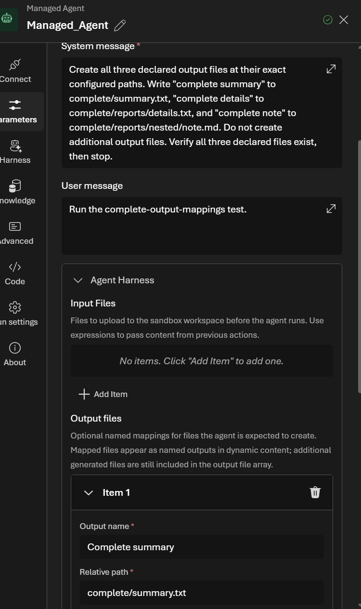
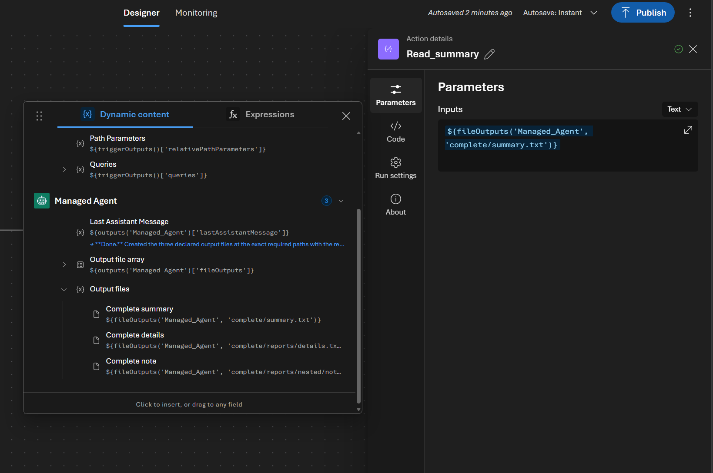
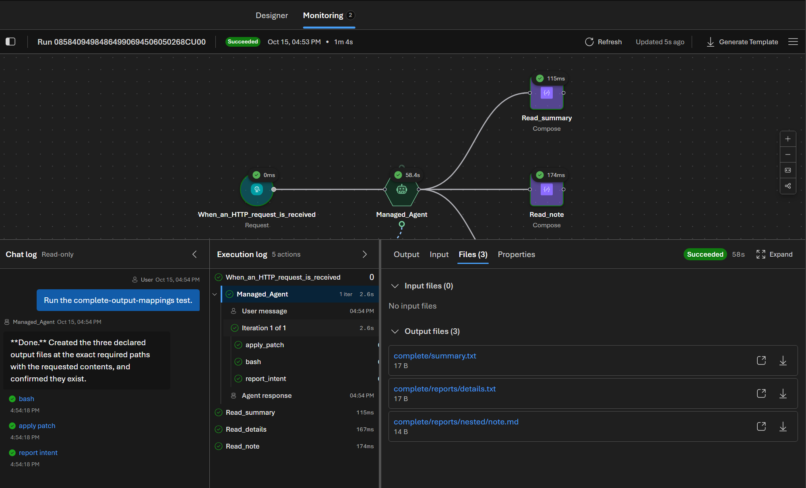

:::note
This capability is in preview and subject to the [Supplemental Terms of Use for Microsoft Azure Previews](https://azure.microsoft.com/support/legal/preview-supplemental-terms/). If your environment enables this capability, the user experience appears in the [portal](https://auto.azure.com).
:::

A Managed Agent can create files in its [sandbox](/features/sandboxes/) and return them to later workflow actions. For example, an agent can create a report, updated source file, archive, image, or test result.

You can use output files in two ways:

| Option | When to use |
|---|---|
| Named output file | You know the expected file path and want a friendly token in **Dynamic content**. |
| Output file array | The number or paths of the files can vary, or you want the complete set of files created by the agent. |

Named output files don't limit what the agent can return. The **Output file array** still includes additional files that aren't mapped.

## Configure named output files

Describe the files that the agent should create in its **System message** (system prompt). Include the purpose, format, and relative path of each expected file. For example:

```text
Create a PDF summary report at outputs/reports/summary.pdf.
Include the main findings and recommendations.
Return the report as a final output file.
```

To make that file available by name in later actions, tie its relative path to a friendly name under **Output files**. The system prompt describes what to produce; the output mapping identifies which file a later action should use.

1. In the [Azure Logic Apps Automation portal](https://auto.azure.com), open your environment, app, and workflow.

1. On the workflow designer, select the Managed Agent action.

1. Select the **Parameters** tab.

1. In **System message**, describe the output files to create, as in the example above.

1. Under **Output files**, select **Add Item**.

1. Provide the following information:

   | Property | Description | Example |
   |---|---|---|
   | **Output name** | A friendly name that appears in **Dynamic content**. | `Summary report` |
   | **Relative path** | The exact path where the agent must create the file, relative to the sandbox workspace. | `outputs/reports/summary.pdf` |

1. Add more output files as needed, and then close the action information window.

Use the same relative path in the system prompt and the output mapping. The platform also tells the agent to create each declared file at its exact relative path and to create any required parent directories. Adding a mapping doesn't replace instructions about the file's contents.

The following example asks the agent to create three text files and maps `complete/summary.txt` to the friendly name **Complete summary**.



### Relative path rules

Use a file path, not a directory path. Follow these rules:

- Use a workspace-relative path, such as `outputs/report.html`.
- You can use nested directories.
- Don't start the path with `/` or a drive letter.
- Don't use empty path segments, `.` segments, or `..` segments.
- Don't declare the same path more than once.

## Use a named output in a later action

After you configure an output file, its friendly name appears under the Managed Agent's **Output files** group in **Dynamic content**.

1. Open the later action, such as an action that uploads a file or sends an attachment.

1. Select its file-content input, and then open **Dynamic content**.

1. Under the Managed Agent's **Output files** group, select the friendly name you configured, such as **Summary report**.

The following example shows the named files and **Output file array** in the picker, with the `complete/summary.txt` file expression in a downstream action.



The designer inserts the file token for you, so you don't need to write an expression. To inspect or edit the expression behind a named token, use:

```text
@fileOutputs('<managed-agent-name>', '<relative-path>')
```

For example:

```text
@fileOutputs('Generate_Report', 'outputs/reports/summary.pdf')
```

The path must match the configured relative path. If the agent doesn't create the file, an action that evaluates this expression fails instead of returning an empty file.

## Use the output file array, including additional files

Use the Managed Agent's **Output file array** in **Dynamic content** when a later action needs the complete collection, including files that aren't listed under **Output files**. In the picker shown above, select **Output file array** instead of an individual named file. You don't need to enter a raw `outputs()` expression.

This is useful when the agent decides how many files to create, file names depend on the input, or you want supporting files as well as the named report.

For example, use the array as the input to a **For each** action to upload or process every returned file. Each file in the array includes its relative path (the file name, including any folders), content, and size. Text files return text content. Binary files return encoded content with its content type.

Named mappings and the array serve different purposes: a named token selects one expected file; the array includes all returned files. Files without a mapping don't receive individual named tokens.

In the system prompt, clearly describe which files are final results, including any supporting files to return. The Managed Agent can return files through the array even if you don't configure any named output files.

## Open or download files from run history

After the workflow runs:

1. Open the workflow's **Monitoring** view.

1. Select the run.

1. In the **Execution log**, select the Managed Agent action.

1. Select the **Files** tab, and then expand **Output files**.

1. Select a file name or **Open** to preview a supported file type. Select **Download** to save the file.

Text, image, and PDF files can open in the portal. For other file types, download the file to open it.



## Troubleshoot output files

| Problem | Try |
|---|---|
| A named output is missing | Confirm that the agent created the file at the exact configured relative path, including directories and the file extension. |
| The `fileOutputs()` expression fails | Confirm the Managed Agent action name and relative path. Also confirm that the file exists in the selected run. |
| A file appears in **Output file array** but has no named token | Add the file under **Output files** when its path is predictable. Additional files only appear in the generic array. |
| No files are returned | Make the agent instructions explicit about the final files to create. Don't ask the agent to leave final results only inside a cloned repository or temporary directory. |
| A relative path is rejected | Use a workspace-relative file path without a leading slash, drive letter, empty segments, `.` segments, or `..` segments. |
| A file can't be previewed | Download the file. The portal preview supports text, images, and PDFs. |

## Related content

- [Agents](/features/agents/)
- [Sandboxes](/features/sandboxes/)
- [Create sandboxes](/guides/create-sandboxes/)
- [Runs and monitoring](/features/runs-and-monitoring/)
